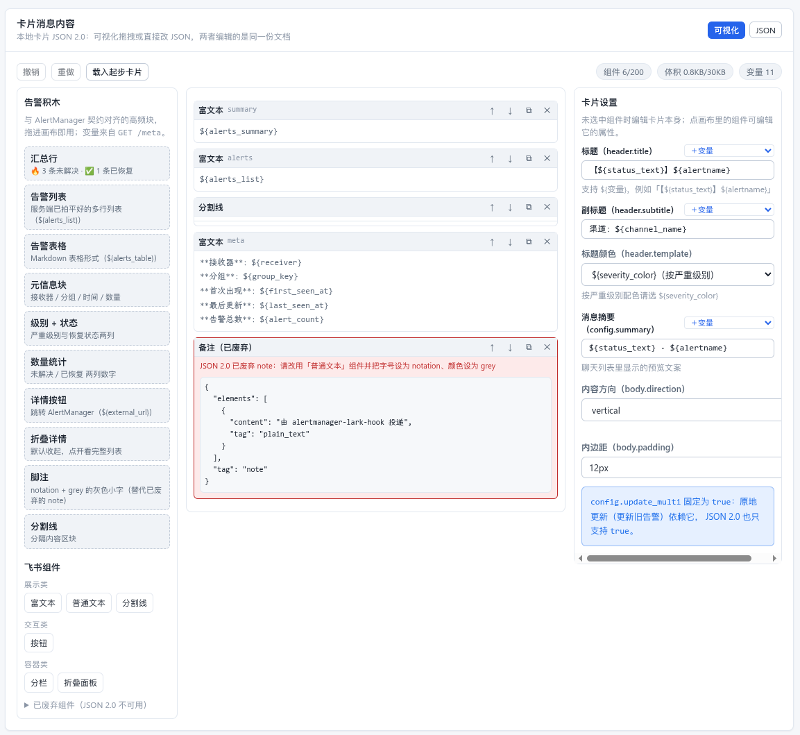

<p align="center">
  
</p>

# alertmanager-lark-hook

把 **Prometheus AlertManager** 的告警，通过**飞书机器人**投递到飞书的群聊或单聊，并且**一条告警只占一条消息**——告警恢复时原地更新或撤回，而不是让群里刷屏。

[](https://github.com/deepseek-ai/deepseek-harness)

---

## 目录

1. [这是个什么应用](#1-这是个什么应用)
2. [部署](#2-部署)
3. [卡片模板与变量](#3-卡片模板与变量)
4. [飞书应用与权限](#4-飞书应用与权限)
5. [开发与测试](#5-开发与测试)
6. [已知限制](#6-已知限制)

---

## 1. 这是个什么应用

### 解决什么问题

AlertManager 自带的飞书通知（不管是飞书的「群自定义机器人 webhook」，还是自己写脚本）几乎都只有一种行为：**每次通知都发一条新消息**。于是一次持续 2 小时的告警，群里会留下 5～10 条重复卡片；告警恢复了，旧的红色卡片还挂在那里误导人。

本项目是一个**独立的告警投递网关**：AlertManager 把 webhook 打给它，由它决定「这条告警该发新消息、还是更新那条旧消息、还是撤回旧消息」，并按渠道配置不同策略。

```
Prometheus ──▶ AlertManager ──webhook──▶ alertmanager-lark-hook ──▶ 飞书群 / 单聊
                                              │
                                    每个渠道一套独立策略 +
                                    一个独立的接收地址
```

### 能做什么

| 能力 | 说明 |
|---|---|
| 发卡片消息 | 交互式卡片（CardKit JSON 2.0），可在管理后台**可视化拖拽构建**，也可直接编辑 / 粘贴 JSON |
| 自动同步渠道 | 一键读取机器人所在的所有群，每个群自动生成一个独立的接收地址 |
| 每个渠道独立规则 | 模板、重复告警、解决告警、分组更新、标签过滤、聚合窗口、发送限流、静默期 |
| 未解决告警 Pin | 可选：分组还有未解决告警时把当前卡片 Pin 到会话的 Pin 列表，全部恢复后自动取消 Pin（不是飞书的「置顶消息」） |
| 原地更新告警卡片 | 告警有新增 / 部分恢复时，把**已发的那张卡片**更新掉，不刷屏 |
| 撤回旧消息 | 重复通知或告警恢复时，可以撤回 / 删除上一条消息 |
| 完整审计与指标 | 每一次接收、发送、更新、撤回、失败都留痕，并暴露 Prometheus 指标 |

### 和「群自定义机器人 webhook」相比

很多团队的第一反应是「AlertManager 直接打飞书的群自定义机器人 webhook 就够了」。差别在这里：

| | 群自定义机器人 webhook | 本项目 |
|---|---|---|
| 发卡片 | ✅ | ✅ |
| **更新已发出的卡片** | ❌ | ✅ 原地更新，不产生新消息 |
| **撤回 / 删除旧消息** | ❌ | ✅ |
| **每个渠道独立的发送策略** | ❌（只能靠 AlertManager 的 route 硬拆） | ✅ 每个群 / 每个人一套 |
| 多群管理 | 每个群一个 webhook URL，模板手抄 N 份 | 同步一次，模板共用 |
| 凭据安全 | webhook URL 泄露 = 可任意发消息 | 飞书应用凭据加密落库、永不回显；Hook 地址可随时查看、一键轮换 |
| 告警去重（AlertManager 重投） | ❌ 会重复发 | ✅ 双重幂等 |
| 发送失败重试 | ❌ | ✅ 自动退避重试 + 手动重试 |
| 审计日志 / 指标 | ❌ | ✅ |

### 首次使用流程

1. 部署（见 §2），用管理员账号登录管理后台
2. 在「设置」里填写飞书应用的 `app_id` / `app_secret`（应用准备见 §4）
3. 在「渠道」页一键同步机器人所在的群，或手工添加用户
4. 在「卡片模板」页导入卡片（见 §3）
5. 在渠道详情里配置发送规则，并**创建一个接收 Hook**，复制列表里的 Hook 地址（地址由「设置 → 对外访问地址」拼出，随时可再看）
6. 把 URL 填进 AlertManager 的 `webhook_configs`（见 §2.6）

---

## 2. 部署

### 2.1 前置条件

| 需要什么 | 说明 |
|---|---|
| 一台能跑容器的机器，或一个已有 Kubernetes 集群 | amd64 / arm64 均可；内存 128 MB 足够 |
| 一个飞书企业自建应用 | 需要机器人能力与若干权限，见 **§4** |
| AlertManager | 任意支持 `webhook_configs` 的版本（协议版本 4） |
| 一个访问地址 | 能同时被浏览器和 AlertManager 访问到；建议配 HTTPS |

> 数据全部存在容器内的 `/data`（嵌入式 SQLite），**不需要**外部数据库、Redis 或消息队列，单容器即可运行。

### 2.2 部署方式

**方式一：使用已发布的镜像（推荐）**

每次推送 tag 都会发布到 GitHub Container Registry，并在 [Releases](https://github.com/fengyifan/alertmanager-lark-hook/releases) 页面上生成 changelog、镜像 digest 与可离线加载的镜像包。

```bash
git clone https://github.com/fengyifan/alertmanager-lark-hook.git && cd alertmanager-lark-hook
cp .env.example .env

# 生成主密钥，填进 .env 的 ALKH_MASTER_KEY；顺便把 ALKH_PUBLIC_BASE_URL 改成你的对外地址、
# 设置 ALKH_ADMIN_PASSWORD
openssl rand -hex 32

# 把 0.1.0 换成 Releases 页面上的实际版本号
docker run -d --name alkh --restart unless-stopped \
  -p 8080:8080 -v alkh-data:/data \
  --env-file .env \
  ghcr.io/fengyifan/alertmanager-lark-hook:0.1.0
# 打开 http://<机器地址>:8080
```

`.env.example` 里全是**容器运行时**读取的变量（清单见 [§2.3](#23-环境变量)）；端口映射与数据卷是部署参数，写在 `docker run` 里，不放进 `.env`。

`latest` 指向最新的**非预发布**版本；生产环境建议固定到 `0.1.0` 这类具体版本。当前只发布 `linux/amd64`。

内网 / 离线环境用 Release 附件里的镜像包：

```bash
docker load -i alertmanager-lark-hook-0.1.0-linux-amd64.docker.tar.gz
```

**方式二：Kubernetes**

清单在 [`deploy/kubernetes.yaml`](deploy/kubernetes.yaml)，包含 Namespace、Secret、ConfigMap、PVC、Deployment、Service；另有一份可选的 [`deploy/kubernetes-ingress.yaml`](deploy/kubernetes-ingress.yaml)。

```bash
kubectl apply -f deploy/kubernetes.yaml
```

**部署前必须改三处**（清单里都有 ⚠️ 标记）：

1. `Secret` 的 `ALKH_MASTER_KEY`（`openssl rand -hex 32`）与 `ALKH_ADMIN_PASSWORD`
2. `ConfigMap` 的 `ALKH_PUBLIC_BASE_URL`（否则接收地址不完整）
3. `image` 建议从 `:latest` 改为固定版本号

暴露服务的三种方式：

| 场景 | 做法 |
|---|---|
| 先试跑 | `kubectl -n alertmanager-lark-hook port-forward svc/alkh 8080:80` |
| 单机 / 内网 | 把 Service 改成 `NodePort`（清单末尾有注释示例） |
| 有 ingress controller | 应用 `deploy/kubernetes-ingress.yaml` |

**三个必须注意的集群侧约束**（清单注释里也写了）：

- **只能单副本**。嵌入式 SQLite 是单写者；聚合窗口、发送限流、卡片更新序号都是**进程内**状态，多副本会导致重复发送与序号冲突。同理不要配 HPA。需要更高可用请部署多套独立实例，各自服务不同渠道。
- **更新策略必须是 `Recreate`**。`ReadWriteOnce` 的 PVC 无法同时挂给两个 Pod，滚动更新会卡在等新 Pod 就绪。
- **确认 StorageClass**。清单里的 PVC 留空 `storageClassName` 以使用默认 class；如果你的集群没有默认 StorageClass，PVC 会一直 `Pending`，需要自行准备 PV 并指定 class（清单末尾有单机 `hostPath` 示例）。SQLite 对 NFS 等共享存储的锁语义支持有限，**优先本地盘**。

**方式三：单文件二进制**

前后端会一起打包进一个可执行文件，不依赖外部文件。自行构建方式见 [开发与测试](docs/development.md)。

### 2.3 环境变量

**没有任何一个变量是「启动时强制必填」的**——全部有默认值，服务一定能起来。但下面标了 **生产必填** 的三个，不设置会在实际使用中出问题，请务必设置。

| 变量 | 作用 | 必填性 | 默认值 |
|---|---|---|---|
| `ALKH_MASTER_KEY` | 加密数据库中保存的飞书 `app_secret`（AES-256-GCM）。32 字节，64 位 hex 或 base64 | **生产必填** | 未设置时自动生成到 `/data/master.key` |
| `ALKH_PUBLIC_BASE_URL` | 生成接收地址用的对外基址，例如 `https://alkh.example.com`；**集群内使用时可以填 Service 的 DNS**（如 `http://alkh.monitoring.svc:8080`），不要求与浏览器访问地址一致 | **生产必填** | 空（此时界面上的接收地址只有路径，无法直接粘贴给 AlertManager） |
| `ALKH_ADMIN_PASSWORD` | 首次启动创建管理员用的密码 | **生产必填** | 空（此时随机生成一个，**只在启动日志里打印一次**） |
| `ALKH_ADMIN_USERNAME` | 管理员用户名 | 建议设置 | `admin` |
| `ALKH_LARK_BASE_URL` | 飞书开放平台基址 | 用 Lark 国际版时必填 | `https://open.feishu.cn`（国际版为 `https://open.larksuite.com`） |
| `ALKH_COOKIE_SECURE` | 登录 Cookie 是否加 `Secure` | 一般不用设：不填时会按 `ALKH_PUBLIC_BASE_URL` 是否为 `https://` 自动判断 | 自动推断（无对外基址时为 `false`） |
| `ALKH_HOOK_RATE_LIMIT` | 未认证的接收端点限流额度（每个来源 IP、每 10 秒；`0` 关闭） | 告警风暴很猛时可以调大 | `300` |
| `ALKH_HTTP_ADDR` | 监听地址 | 否 | `0.0.0.0:8080` |
| `ALKH_DATA_DIR` | 数据目录（SQLite、主密钥） | 否 | `/data` |
| `ALKH_DATABASE_URL` | 直接指定数据库 URL，一般不用改 | 否 | `sqlite://{ALKH_DATA_DIR}/alkh.db` |
| `ALKH_DB_MAX_CONNECTIONS` | SQLite 连接池上限 | 否 | `8` |
| `ALKH_LOG_LEVEL` | 日志级别 | 否 | `info` |
| `ALKH_LOG_JSON` | 输出 JSON 格式日志 | 否 | `false` |
| `ALKH_RETRY_INTERVAL_SECS` | 扫描失败投递的间隔（秒） | 否 | `30` |
| `ALKH_RETENTION_INTERVAL_SECS` | 清理历史数据的间隔（秒） | 否 | `3600` |
| `ALKH_WORKER_TICK_MS` | 聚合窗口冲刷频率（毫秒） | 否 | `200` |
| `ALKH_STATIC_DIR` | 用磁盘目录代替内嵌前端 | 仅前端开发用 | 空 |

> ⚠️ **`ALKH_MASTER_KEY` 一定要备份。** 一旦丢失，数据库里加密保存的飞书 `app_secret` 就**无法解密**，只能重新在管理后台填一遍。如果你选择不设置（让它自动生成到 `/data/master.key`），那这个文件就在数据卷里，备份数据卷即可。
>
> 数据保留天数（告警分组 / 投递 / 审计）不在环境变量里，在管理后台「设置」页调整，默认 30 / 30 / 14 天。
> **卡片内时间的展示时区**同样在「设置」页调整（IANA 名，默认 `UTC`；例如填 `Asia/Shanghai`，
> 卡片时间即按东八区渲染 `2026-10-16 11:04:19 +08:00`）。它只影响卡片里的展示字符串——
> AlertManager 推来的时间戳与库内存储仍是 RFC 3339 UTC。

### 2.4 数据与备份

| 路径 | 内容 |
|---|---|
| `/data/alkh.db`（含 `-wal` / `-shm`） | 渠道、Hook（含加密后的 Hook token，用于回显地址）、模板、策略、告警历史、投递记录、审计日志、加密后的飞书凭据 |
| `/data/master.key` | 仅在未设置 `ALKH_MASTER_KEY` 时存在 |

备份：把整个 `/data` 卷（或目录）复制走即可。停止容器后复制最稳妥；运行中复制也可以，因为 SQLite 开了 WAL。

### 2.5 上线检查清单

- [ ] 设置了 `ALKH_MASTER_KEY`、`ALKH_PUBLIC_BASE_URL`、`ALKH_ADMIN_PASSWORD`
- [ ] 通过 HTTPS 暴露并正确填写 `ALKH_PUBLIC_BASE_URL`（`Secure` 会自动跟上）
- [ ] 登录后**立刻修改初始密码**（设置页 → 修改密码）
- [ ] `/data` 挂了持久化卷，并纳入备份
- [ ] 确认 `/healthz` 返回 200（容器已内置健康检查）
- [ ] 在测试渠道里点一次「发送测试」，确认机器人能发出消息

> 反向代理（Nginx / Traefik 等）请把 `/` 全量转发到 8080，不要只代理 `/api`——前端页面也在同一个端口上。接收地址是 `/api/v1/hooks/alertmanager/{token}`，注意不要被网关的鉴权拦截。

**给运维用的三个端点**

| 端点 | 用途 |
|---|---|
| `GET /healthz` | 存活探针，恒返回 200 与版本号 |
| `GET /readyz` | 就绪探针，同时报告数据库是否可写、飞书凭据是否已配置 |
| `GET /metrics` | Prometheus 文本指标：接收量、发送/更新/失败数、聚合冲刷、飞书错误数等 |

容器的 `HEALTHCHECK` 已经内置（`alkh --healthcheck`，做一次 TCP 连通性探测），Kubernetes 下直接指向 `/healthz` 与 `/readyz` 即可，不需要额外装 `curl`。

### 2.6 接入 AlertManager

每个渠道都会生成一个**独立**的接收地址，形如：

```
https://alkh.example.com/api/v1/hooks/alertmanager/alkh_xxxxxxxxxxxxxxxx
```

> 地址的主机部分来自「设置 → 对外访问地址」（`ALKH_PUBLIC_BASE_URL`），**不是**你当前浏览器的地址：
> AlertManager 在集群内访问本项目时，这里就该填集群内可达的 DNS（例如 `http://alkh.monitoring.svc:8080`）。
> 后台列表里的 Hook 地址始终按这个配置生成，可以随时查看、复制；地址泄露就点一次「轮换 token」。

把地址填进 AlertManager 的 receiver：

```yaml
route:
  receiver: lark-ops
  # 分组维度决定投递到本项目时的 groupKey，也是本项目区分「同一个告警分组」的依据
  group_by: ['alertname', 'severity']
  group_wait: 30s
  group_interval: 5m
  # 这是 AlertManager 侧的重复通知间隔；本项目侧的「重复告警」策略决定收到后怎么处理
  repeat_interval: 4h

receivers:
  - name: lark-ops
    webhook_configs:
      - url: https://alkh.example.com/api/v1/hooks/alertmanager/alkh_xxxxxxxxxxxxxxxx
        send_resolved: true          # ⚠️ 必须为 true，否则本项目收不到「解决告警」
        max_alerts: 50               # 超出部分由 AlertManager 截断
        timeout: 10s
```

完整示例见 [`deploy/alertmanager.example.yml`](deploy/alertmanager.example.yml)。

> **为什么要区分不同的接收地址？** 一个地址 = 一个渠道 + 一套策略。你可以让 `severity=critical` 走「值班群」的地址、其余走「普通群」的地址，两边用不同的卡片模板和不同的重复策略——这正是 AlertManager 的 `route` 做不到的（它只能拆 receiver，拆不出「同一个 receiver 内不同策略」）。

**关于分组与重复的两条要点**

- AlertManager 的 `group_by` 决定分组键。本项目按「接收地址 + 分组键」识别一个告警分组，并记录它的首次出现时间、最后更新时间、恢复时间。
- 本项目默认 **不发送重复通知**（AlertManager 每 `repeat_interval` 打一次，本项目只更新内部状态）。如果希望每次都重新提醒，把渠道策略里的「重复告警」改成「发送」；如果希望「发新的并撤回旧的」，选「发送并移除旧告警」。
- 想让未解决告警卡片固定在会话里随时可查：把渠道策略里的「未解决告警 Pin」打开。分组还有未解决告警时，当前卡片会被 Pin 到会话的 **Pin 列表**；全部恢复（或关掉开关）后自动取消 Pin。该操作调用飞书的 `im/v1/pins` 接口（**不是**飞书客户端的「置顶消息」，后者是另一套能力），机器人必须在群内，且群不能限制成「仅群主/管理员可 Pin」；失败不会影响告警投递，只会记日志与指标。

---

## 3. 卡片模板与变量

本项目只发一种消息：**卡片消息**（会话里的交互式卡片，群聊与用户都能收）。
模板就是**本地的卡片 JSON 2.0**，在管理后台可视化拖拽构建或直接编辑。

### 3.1 新建卡片消息模板



上图中画布里的「备注（已废弃）」节点，就是校验拦下来的 JSON 1.0 组件（`note`）——
2.0 结构会直接拒绝它，所以编辑器在保存前就把原因和替代写法标了出来。

**方式 A：可视化拖拽（推荐）**

1. 管理后台 →「卡片模板」→ 新建——编辑器会自动载入内置的**起步卡片**
2. 从左侧拖「**告警积木**」（汇总行 / 告警列表 / 详情按钮 …）到画布，或拖飞书组件自由排版
3. 在右侧属性面板改内容，文本框旁的「＋变量」可直接插入内置变量
4. 点「校验」→「预览」→「发送草稿测试」确认无误，再保存

**方式 B：直接编辑 / 粘贴 JSON**

切到「JSON」页签即可改源码，也支持粘贴从[飞书卡片搭建工具](https://open.feishu.cn/cardkit)导出的
`*.card`/JSON（两个页签编辑的是**同一份文档**，来回切换不会丢改动）。

> ⚠️ 必须是 **卡片 JSON 2.0 结构**（顶层 `"schema": "2.0"`、组件放在 `body.elements` 下）。
> JSON 2.0 **不支持** `note` / `action` 这类 1.0 组件——本工具会在校验阶段直接拦住并给出替代写法。
> 需要「按告警循环」时，用本工具提供的 **`repeat`（循环）/ `if`（条件）本地指令**（见下），
> 它们保存的是指令本身，服务端渲染时才展开成飞书认识的组件。

> 早期版本支持「引用搭建工具发布的 `template_id`」这一来源，现已**停用**：
> 搭建工具模板无法在本地校验、预览与版本化，容易"预览通过、发送失败"。
> 历史模板仍可打开与预览，编辑器会提示一键「转换为本地卡片」。

### 3.2 变量语法

在卡片的**字符串字段**里写 `${变量名}`，发送时会被替换成真实内容：

```json
{
  "schema": "2.0",
  "header": {
    "template": "${status_color}",
    "title": { "tag": "plain_text", "content": "【${status_text}】${alertname}" }
  },
  "body": {
    "elements": [
      { "tag": "markdown", "content": "${alerts_summary}" },
      {
        "tag": "repeat",
        "source": "alerts",
        "max_items": 20,
        "empty_content": "无告警",
        "elements": [
          { "tag": "markdown", "content": "**${item.title}**（${item.status_text}）" },
          { "tag": "if", "when": "${item.summary}",
            "elements": [{ "tag": "markdown", "content": "　‣ 概要：${item.summary}" }] }
        ]
      },
      { "tag": "markdown", "content": "**实例**：${instance}\n**开始**：${starts_at}" }
    ]
  }
}
```

**本地指令：循环（`repeat`）与条件（`if`）**

| 指令 | 作用 | 关键字段 |
|---|---|---|
| `repeat` | 对告警数组逐条渲染 `elements` 里的子组件 | `source`（目前为 `alerts`）、`max_items`（最多循环几次，还受渠道策略限制）、`empty_content`（没有告警时显示的 Markdown） |
| `if` | 条件成立时才渲染 `elements` | `when`（渲染结果为空 / `false` / `0` / `no` / `off` 视为「否」）、`equals`（可选的精确相等判断）、`negate`（反转） |

两者都可以**自由嵌套**（循环里放条件，容器里放循环……），循环体内用 `${item.*}` 取当前这条告警。

支持以下几种写法：

| 写法 | 含义 |
|---|---|
| `${alertname}` | 使用下表中的变量 |
| `${label:team}` | 直接取告警的某个**标签**，适合与内置变量重名时使用 |
| `${annotation:runbook_url}` | 直接取告警的某个**注解** |

另外，**任何标签或注解都可以直接用原名引用**（例如 `${team}`、`${cluster}`），不需要前缀——除非它和内置变量重名（见 3.4）。

### 3.3 变量速查表

> 标记说明：**AM 标准** = 与 AlertManager 通知模板同名同义；**社区约定** = Prometheus 生态的事实约定，但 AlertManager 并不强制；**本项目** = 本服务自己计算的扩展变量。
>
> ⚠️ 请留意：**本项目用的是 `${...}` 语法，不是 AlertManager 的 Go 模板语法 `{{ ... }}`**。从 AlertManager 文档里复制的占位符不会被替换。

<!-- variable-table:start -->

**分组级**

| 变量 | 含义 | 来源 | 示例值 |
|---|---|---|---|
| `${status}` | 分组状态 | **AM 标准**（`.Status`） | `firing` / `resolved` |
| `${status_text}` | 同上，中文文案 | 本项目 | `未解决` / `已恢复` |
| `${status_color}` | 状态对应的卡片颜色：未恢复按严重级别，**全部恢复后为 `green`** | 本项目 | `red` / `orange` / `blue` / `grey` / `green` |
| `${is_firing}` | 是否还有未解决告警 | 本项目 | `true` / `false` |
| `${receiver}` | AlertManager 的 receiver 名 | **AM 标准**（`.Receiver`） | `lark-ops` |
| `${group_key}` | 告警分组键 | AM webhook 字段 `groupKey` | `{}:{alertname="HighCPU"}` |
| `${external_url}` | AlertManager 外部地址 | **AM 标准**（`.ExternalURL`） | `http://am:9093` |
| `${alert_count}` | 本次告警总条数 | 本项目 | `3` |
| `${firing_count}` | 未解决条数 | 本项目 | `2` |
| `${resolved_count}` | 已恢复条数 | 本项目 | `1` |
| `${truncated_alerts}` | 被 AlertManager 截断的条数 | AM webhook 字段 | `0` |
| `${severity}` | 严重级别原值（优先取公共标签） | **社区约定** | `critical` |
| `${severity_text}` | 严重级别中文 | 本项目 | `严重` / `警告` / `提示` / `未知` |
| `${severity_color}` | 严重级别对应的卡片颜色（**不随恢复变化**，需要状态色请用 `${status_color}`） | 本项目 | `red` / `orange` / `blue` / `grey` |
| `${channel_name}` | 消息渠道名（群名或用户名） | 本项目 | `运维告警群` |
| `${channel_id}` | 渠道的接收者 ID | 本项目 | `oc_a0553eda...` |
| `${first_seen_at}` | 该分组**首次**出现的时间 | 本项目 | `2026-10-13 08:00:00 +08:00` |
| `${last_seen_at}` | 该分组**最后**一次更新的时间 | 本项目 | `2026-10-13 08:15:00 +08:00` |
| `${resolved_at}` | 恢复时间（未恢复为空） | 本项目 | `2026-10-13 08:20:00 +08:00` |
| `${now}` | 当前时间 | 本项目 | `2026-10-13 08:21:03 +08:00` |
| `${group_labels}` | `groupLabels` 的 JSON 字符串 | **AM 标准**（形态不同） | `{"alertname":"HighCPU"}` |
| `${common_labels}` | `commonLabels` 的 JSON 字符串 | **AM 标准**（形态不同） | `{"severity":"critical"}` |
| `${common_annotations}` | `commonAnnotations` 的 JSON 字符串 | **AM 标准**（形态不同） | `{"summary":"CPU 过高"}` |

> **时间变量的时区**：`${first_seen_at}` / `${last_seen_at}` / `${resolved_at}` / `${now}` /
> `${starts_at}` / `${ends_at}` / `${item.starts_at}` / `${item.ends_at}` 统一按管理后台
> 「设置 → 时间展示时区」（IANA 名，默认 `UTC`）渲染；上表示例按 `Asia/Shanghai` 给。
> AlertManager 侧的时间戳始终是 RFC 3339 UTC，本项目只在展示字符串上换算。

**代表告警**（⚠️ 取的是**一条**代表告警，不是整组：优先第一条未解决的，否则第一条）

| 变量 | 含义 | 来源 | 示例值 |
|---|---|---|---|
| `${alertname}` | 告警名称 | **社区约定**（Prometheus 保留标签） | `HighCPUUsage` |
| `${instance}` | 实例 | **社区约定**（Prometheus 保留标签） | `10.0.0.1:9100` |
| `${job}` | job | **社区约定**（Prometheus 注入） | `node-exporter` |
| `${summary}` | 告警概要（取自注解 `summary`） | **社区约定** | `CPU 使用率 92%` |
| `${description}` | 告警详情（取自注解 `description`） | **社区约定** | `持续 5 分钟` |
| `${fingerprint}` | 告警指纹 | **AM 标准**（每条告警） | `a1b2c3d4e5f6a7b8` |
| `${alert_status}` | 代表告警自身的状态 | **AM 标准**（每条告警） | `firing` / `resolved` |
| `${starts_at}` | 代表告警的开始时间 | **AM 标准**（每条告警） | `2026-10-13 08:00:00 +08:00` |
| `${ends_at}` | 代表告警的结束时间（未结束为空） | **AM 标准**（每条告警） | — |
| `${generator_url}` | 告警来源链接（通常是 Prometheus 图表） | **AM 标准**（每条告警） | `http://prom:9090/graph?...` |

**预渲染块**（已经排版好的 Markdown，直接放进 `markdown` 组件即可）

| 变量 | 渲染成什么 | 适用场景 |
|---|---|---|
| `${alerts_summary}` | 一行汇总，如 `🔥 2 条未解决 · ✅ 1 条已恢复` | 卡片顶部 |
| `${alerts_list}` | 逐条列出状态、告警名、实例、概要、时间（**兼容保留**，新模板请用「循环」组件） | 卡片主体 |
| `${alerts_table}` | 把告警排成 Markdown 表格 | 想紧凑展示时 |
| `${has_alerts}` | 本次分组是否有告警，`true` / `false` | 配合「条件」组件做空列表兜底 |

**循环内**（只有放进「循环」组件的**子组件**里才有值；取的是**当前这一条**告警）

| 变量 | 含义 | 示例值 |
|---|---|---|
| `${item.index}` | 当前告警序号（从 1 开始） | `1` |
| `${item.title}` | 「名称 · 实例」 | `HighCPU · 10.0.0.1:9100` |
| `${item.alertname}` | 当前告警的名称 | `HighCPU` |
| `${item.instance}` | 当前告警的实例 | `10.0.0.1:9100` |
| `${item.job}` | 当前告警的 job | `node-exporter` |
| `${item.fingerprint}` | 当前告警的指纹 | `a1b2c3d4e5f6a7b8` |
| `${item.status}` | 当前告警状态 | `firing` / `resolved` |
| `${item.alert_status}` | 同上（与代表告警的 `${alert_status}` 对齐，便于迁移） | `firing` / `resolved` |
| `${item.status_text}` | 当前告警状态（中文） | `未解决` / `已恢复` |
| `${item.status_icon}` | 当前告警状态图标 | `🔥` / `✅` |
| `${item.is_firing}` | 当前告警是否未解决 | `true` / `false` |
| `${item.status_color}` | 当前告警状态对应颜色 | `red` / `green` |
| `${item.severity}` | 当前告警严重级别原值 | `critical` |
| `${item.severity_text}` | 当前告警严重级别（中文） | `严重` / `警告` / `提示` |
| `${item.severity_color}` | 当前告警严重级别对应颜色 | `red` / `orange` / `blue` / `grey` |
| `${item.summary}` | 当前告警的概要注解 | `CPU 使用率 92%` |
| `${item.description}` | 当前告警的详情注解 | `持续 5 分钟` |
| `${item.starts_at}` | 当前告警的开始时间 | `2026-10-13 08:00:00 +08:00` |
| `${item.ends_at}` | 当前告警的结束时间（未结束为空） | — |
| `${item.generator_url}` | 当前告警的来源链接 | `http://prom:9090/graph?...` |

<!-- variable-table:end -->

**自定义取值**（不属于内置变量，而是语法）

| 写法 | 含义 |
|---|---|
| `${label:名称}` | 取任意标签，如 `${label:team}` |
| `${annotation:名称}` | 取任意注解，如 `${annotation:runbook_url}` |
| `${名称}` | 直接用标签 / 注解原名，如告警标签里有 `team` 就可以写 `${team}` |
| `${item.label:名称}` | **循环内**取当前告警的任意标签，如 `${item.label:team}` |
| `${item.annotation:名称}` | **循环内**取当前告警的任意注解，如 `${item.annotation:runbook}` |
| `${item.labels.名称}` | 同上，点号写法，如 `${item.labels.team}` |

### 3.4 四个必须知道的注意事项

1. **`${starts_at}` / `${summary}` / `${instance}` 只代表一条告警。** AlertManager 里这些字段必须写在 `{{ range .Alerts }}` 循环里逐条访问；本项目为了「一张卡片装下一组告警」做了扁平化，所以它们取自**代表告警**。要逐条展示全部告警，请把内容放进「循环」组件的子组件里并改用 `${item.*}`（旧的 `${alerts_list}` 变量仍然可用，但看不清结构、也没法逐项改）。

2. **内置变量会盖住同名标签。** 如果你的告警里正好有一个叫 `status` 或 `summary` 的**标签**，`${status}` 拿到的是内置值，不是你的标签值。这时请用显式写法 `${label:status}`。

3. **JSON 2.0 会拒绝它不认识的字段。** 1.0 时代多余的属性会被忽略，2.0 会**直接报错**（例如 `note`、`action` 这两个 1.0 组件已废弃）。本工具在保存前就用组件目录拦下这些问题并给出替代写法，别等飞书返回错误码。另外目前不支持 `{{ }}` 这类 AlertManager 写法。

4. **「循环 / 条件」是本工具的本地指令，不是飞书组件。** 保存的卡片里存的是 `repeat` / `if`，服务端发送与预览时才展开；展开后仍受飞书两条硬限制约束：单卡 ≤200 个组件、≤30KB。循环次数先由 `max_items` 与渠道策略的「单条消息最多展示告警数」压住，展开时再共享一份 200 组件预算：名额用完后**按文档顺序**丢弃剩余组件（靠后的脚注/按钮可能被长循环挤掉，编辑器顶部的「展开约 N」给出量级提示）。体积超限时会自动截断最长的文本字段；但截断只压缩文本、无法压缩 JSON 结构本身，所以 30KB 是尽力而为而不是绝对保证——把内容堆到几百个组件仍有被飞书拒收的可能。

### 3.5 校验、预览与 mock 数据

新建 / 编辑模板时可以用这些手段自检：

- **画布实时计数**：顶部显示「组件 N/200、体积 N/30KB、变量 N」，超限立即变红（保存会被拒绝）。
- **校验**：检查 JSON 合法性、2.0 结构、组件嵌套规则、`element_id` 唯一性，并列出「检测到的变量」和「未知变量」。未知变量不报错，但渲染时会变成**空串**——所以出现未知变量通常意味着拼错了。
- **预览**：用内置样例（`firing` / `resolved`）渲染一遍，直接看到最终卡片内容。
- **Mock 数据**：预览和测试发送共用的模拟数据面板。基线可以选内置样例，也可以**直接选一条历史告警分组**——用真实告警试最省事；在此之上可以逐项覆盖任意变量（含 `label:team` 这类动态 key），覆盖项会显示「已覆盖」，可逐条清除或整批重置。历史分组只作数据源，**不会被改写**。
- **发送草稿测试**：用当前编辑器里的内容（含 mock 覆盖）往真实渠道发一条，**不需要先保存模板**；草稿不落库，投递记录里记 `kind=test`。已保存的模板则走「用已保存模板发送」。

配置好渠道后，也可以在渠道详情页点「发送测试」，往真实群 / 人发一条，确认整条链路。

### 3.6 内置默认模板

首次启动会自动创建一个默认模板（「默认告警卡片」），开箱即用。渠道策略没指定模板时就用它，保证**告警不会因为模板问题而丢失**。

默认卡片的内容由后端 [`crates/alkh-app/src/defaults.rs`](crates/alkh-app/src/defaults.rs) 提供，编辑器新建模板时也用它起步（`GET /card-templates/default`）——只有一份事实来源，不会出现"编辑器里的起步卡"和"兜底卡"不一致。

---

## 4. 飞书应用与权限

### 4.1 创建应用

1. 打开[飞书开放平台](https://open.feishu.cn/app) → 创建**企业自建应用**
2. 「添加应用能力」→ 添加 **机器人**
3. 按 §4.2 申请权限
4. 「版本管理与发布」→ 创建版本并**发布**（机器人能力与权限都要发布后才生效）
5. 把 `app_id` / `app_secret`（在「凭证与基础信息」页）填进本项目的「设置」页，点「测试飞书凭据」验证

### 4.2 必需权限

| 权限 | 用来做什么 | 是否必需 | 备选 |
|---|---|---|---|
| `im:message` | 发送消息 | ✅ 二选一 | `im:message:send_as_bot` |
| `im:message:send_as_bot` | 以应用身份发消息 | ✅ 二选一 | `im:message` |
| `im:chat:readonly` | 读取机器人所在的群列表（渠道同步） | ✅ 二选一 | `im:chat` |
| `cardkit:card:write` | 创建 / 更新卡片实体（「更新旧告警」依赖它） | ✅ **必需** | — |
| `im:message:recall` | 撤回旧消息（「发送并移除旧告警」依赖它） | ⭕ 只在用撤回策略时需要 | `im:message` |
| `contact:user.employee_id:readonly` | 让接口响应里返回 user_id 字段 | ➖ 可选 | — |

**最小可用集合**（只用卡片消息、不用撤回）：

```
im:message:send_as_bot
im:chat:readonly
cardkit:card:write
```

### 4.3 可用范围与拉群

飞书对「机器人能给谁发消息」有硬性限制，配好权限后还要做两件事：

| 场景 | 需要做什么 |
|---|---|
| 发到**群** | 把机器人**拉进该群**（并且群设置允许机器人发言） |
| 发给**用户** | 该用户必须在应用的**可用范围**内（开发者后台 → 应用发布 → 版本管理与发布 → 可用范围） |

常见失败提示与原因：

| 报错 | 原因 |
|---|---|
| `230002 The bot can not be outside the group.` | 机器人不在目标群里 |
| `230013 Bot has NO availability to this user.` | 用户不在应用的可用范围内 |
| `230006 Bot ability is not activated.` | 没加机器人能力，或加了但没发布版本 |

### 4.4 卡片模板的授权（仅历史模板需要）

> 本地卡片 JSON 2.0 由本应用自己创建卡片实体（`cardkit/v1/cards`），**不需要**这一步。
> 只有仍然引用搭建工具 `template_id` 的历史模板（该来源已停用）才需要：

用 `template_id` 方式引用搭建工具发布的卡片时，**必须把本应用加为该卡片的可用应用**，否则发送会报「无卡片使用权限」：

1. 打开该卡片模板的编辑页 → 点应用图标
2. 在「添加自定义机器人 / 应用」里加上本应用
3. 确认卡片已**保存并发布**（未发布的模板会报 `200380 template does not exist`）

建议把这类历史模板尽快「转换为本地卡片」，之后就不需要维护授权与版本号了。

---

## 5. 开发与测试

本仓库的开发者文档（本地开发环境、目录结构、构建、测试、代码规范、契约维护）已移出本文件：

**➡️ [docs/development.md](docs/development.md)**

架构与内部设计文档：

| 文档 | 内容 |
|---|---|
| [`docs/architecture.md`](docs/architecture.md) | 分层架构、限界上下文、关键设计决策、部署拓扑 |
| [`docs/domain-model.md`](docs/domain-model.md) | 聚合 / 实体 / 值对象、状态机、数据库 schema |
| [`docs/business-rules.md`](docs/business-rules.md) | 接收流水线、事件分类、**投递决策表**、R1–R18 补充规则 |
| [`docs/card-builder-model.md`](docs/card-builder-model.md) | **卡片编辑器的建模分析**：本质、现状模型、目标模型（AST / 绑定 / 身份 / 代价）与改进路线 |
| [`docs/api.md`](docs/api.md) | 全部 REST 接口契约（请求 / 响应 / 枚举 / 错误码） |
| [`docs/research/feishu-api.md`](docs/research/feishu-api.md) | 逐条核对的飞书开放平台接口（URL、字段、权限、示例） |

---

## 6. 已知限制

以下几处来自飞书官方文档的**未确认细节**，生产使用前建议在测试租户验证一遍（详细清单见 [`docs/research/feishu-api.md`](docs/research/feishu-api.md) 的 *Gaps / uncertainties*）：

- `${...}` 占位符是**本项目的模板约定**。飞书官方文档只描述了搭建工具的「变量 + `template_variable` 键值映射」，没有文档化的 `${...}` 语法。
- **消息撤回时限由企业管理员策略决定**，不是固定值。超出时限的撤回会失败（本项目会记录下来但不阻塞主流程）。
- 飞书**没有按名称精确查找群**的接口（只有关键词搜索），所以渠道同步只能列出机器人所在的全部群。
- 卡片实体有效期 **14 天**，且每个卡片实体**只能发送一次**。超过 14 天的旧卡片无法原地更新，此时本项目会自动降级为「发新消息」而不是报错。
- **飞书 JSON 2.0 没有循环容器**（循环容器仅搭建工具可用，且不能再嵌一层；JSON 导入的卡片完全不支持）。所以「按告警循环」由本工具的 **`repeat` / `if` 本地指令**实现：保存的是指令，**服务端渲染时才展开**成飞书认识的组件（见 §3.2）；展开结果同样受 200 组件 / 30KB 限制。旧的 `${alerts_list}` / `${alerts_table}` 变量继续可用（服务端把一组告警拍平成 markdown），但不再推荐用于新模板。

其他行为约定：

- `ok: true` 只代表**请求已受理**，不代表消息已发出。真实结果看投递记录的 `state`（`active` 已发出 / `pending` 待重试 / `failed` 失败）。
- 发送失败会按 1s / 5s / 30s / 2m / 10m 退避重试 5 次；**只有 `pending` 会进这个后台队列**。
- 不可重试的错误（如飞书权限不足 `99991672`、机器人不在群）会直接落 `failed`，**不会**自动重试。修好原因后在投递记录里点「重试」：它是**立即重发一次**并显示本次结果，失败原因看该投递的 `last_error`。
- 投递所属的告警分组被删除后，该投递的重试会返回 404（`alert_group_id` 已悬空），需要等新的告警事件重建分组。
- 未配置飞书凭据时，收到的告警会被记录为 `pending`，配好凭据后会自动补发。
